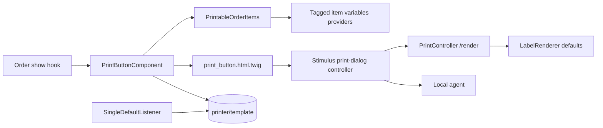

# Requirements

### Overview & Goals
Refactor the order-page batch print feature so it is a pure *pick printable items + printer + template* dialog, add admin-configurable default printer/template, and move the modal's JS/CSS/HTML out of the inline Twig script into the `assets/` directory.

### Scope
**In scope**
- Order batch dialog shows no label-template variable fields (no code/ean13/footer/madeIn/icons inputs).
- Only printable items are listed: order items whose variant has a non-empty EAN (`ProductVariant::ean` in zangra-sylius).
- Values come from the order item: `code` = variant code, `ean13` = variant EAN, `quantity` = item quantity (editable per row, as today). All other template variables (e.g. `footer`, `madeIn`) use the variable's configured default value (the server renderer already does this when a value is omitted).
- **Extension point:** the host app (zangra-sylius) can add extra per-row variable values (e.g. `madeIn` from a product attribute, later others) by registering a tagged service; no plugin code or template has to be overridden. The values are sent to `/render` but are never shown as editable fields.
- User still chooses printer and label template; both are preselected from the defaults.
- A "default" flag on `LabelPrinter` and `LabelTemplate`, editable in admin forms, visible in grids; at most one default per type.
- Separation of concerns: Twig renders the modal HTML, a Stimulus controller holds behavior, SCSS holds styles (in `assets/admin`).

**Out of scope**
- The zangra-sylius side (`ProductVariant::ean`, country product attribute -> `madeIn`). The plugin only reads the EAN by property path.
- Changing the `/render` endpoint contract or the local agent.
- The single-print button (product variant page) keeps its variable form; it only gains default preselection and the new asset structure.

### Functional Requirements
- Order show page: "Print label" button appears only if at least one printable item exists.
- Rows: checkbox, variant code, quantity (default = ordered quantity); select/deselect-all (tri-state); Print button; warning when nothing is checked.
- One `/render` request per checked row; payload `variables` = `{...extra variables from providers, code, <ean13 variable key>: ean}`; stops at first failure with the code prefixed to the error.
- Host providers can add (or leave out) any variable per order item; `code` / `ean13` always come from the order item and cannot be overridden. A provider returning nothing for an item leaves the template default in effect.
- Printer / template selects preselect the default entity when it is enabled, otherwise the first one.
- Setting `isDefault` on one printer/template unsets it on all others of the same type.

### Answer to the question (assets)
Yes, it is simpler and more maintainable: the inline `<script>` currently builds the whole DOM with an `el()` helper and is re-included for each button. After this change Twig owns the markup, `assets/admin/controllers/print-dialog_controller.js` owns behavior and `assets/admin/scss/print-dialog.scss` owns the styling. Trade-off: the host app must build and load the plugin's admin entrypoint (the test app already builds `plugin-admin-entry`).

# Technical Design

### Current Implementation
- `templates/admin/print_script.html.twig` (408 lines): inline JS (`PrintDialog`) that creates the `<dialog>`, variable fields, item rows, inline `style=` attributes; config passed as JSON in `data-zangra-barcode-print` by `templates/admin/print_button.html.twig`.
- `src/Twig/Component/PrintButtonComponent.php`: props `defaults`, `templateCode`, `label`, `items`; `getTemplates()`, `getPrinters()`, `getRows()`, `getIcons()`.
- `templates/admin/order/print_button.html.twig` + `config/twig_hooks/admin/order.yaml`: builds `items` from `order.items` (variant code + quantity) in Twig.
- `src/Label/LabelRenderer::resolve()` already falls back to `LabelTemplateVariable::getDefaultValue()` when a value is `null`/empty, so omitted variables (footer, madeIn) use their defaults without server changes.
- `assets/admin/entrypoint.js` and `controllers.json` are empty skeleton files; the test app webpack (`vendor/sylius/test-application/webpack.config.js`) already builds `plugin-admin-entry` from `assets/admin/entrypoint.js` and merges `assets/admin/controllers.json`. `templates/admin/shared/layout/base/{scripts,styles}.html.twig` reference `app-admin-entry` and are not hooked anywhere (skeleton leftovers).
- Entities `LabelPrinter` / `LabelTemplate` (attribute mapping, `enabled` flag), migration `src/Migrations/Version20261019000001.php`, forms `LabelPrinterType` / `LabelTemplateType`, `config/grids.yaml`.

### Key Decisions
1. **Default storage: entity flag** `isDefault` (bool, column `is_default`) on `LabelPrinter` and `LabelTemplate`, new migration, form checkbox, grid column. Uniqueness enforced by a Doctrine listener (DQL `UPDATE ... SET isDefault = false WHERE id <> :id` after persist/update when the flag is true).
2. **Assets: Stimulus controller + SCSS** in `assets/admin`, modal markup rendered by Twig (messages via `|trans` directly in the template, no `messages` JSON). The controller is registered from `assets/admin/entrypoint.js` / `controllers.json` so the host only wires the plugin entrypoint; first implementation step verifies registration in the test app (fallback: `entrypoint.js` starts its own `@hotwired/stimulus` Application and registers the controller, which does not conflict with the host's app).
3. **EAN source: property path** read with Symfony `PropertyAccessor` (`zangra_sylius_barcode_print.ean_property_path`, default `ean`). Variants where the path is unreadable or empty are skipped; no dependency on host entity classes.
4. **Order data resolved in PHP**, not Twig: a `PrintableOrderItems` service turns an order into rows (enriched by host providers, see 5); the component receives `order`.
5. **Extension point = tagged provider service, consumed by `PrintableOrderItems` (not by `PrintButtonComponent::getRows()` itself).** `getRows()` stays a thin delegate, so every caller (order hook, custom `order` usage) gets the enrichment, and the host never has to decorate/extend a `final` Twig component. Each row gets a `variables` map (`array<string, string|list<string>>`) merged from all providers; the Stimulus controller sends `{...row.variables, code, <ean13 key>: ean}`. Alternatives rejected: Twig-side `items` built by the host (loses the EAN filter and PHP typing), a Symfony event (heavier, implicit ordering), decorating the component (class is `final`).

### Proposed Changes
**PHP**
- `Entity/LabelPrinter`, `Entity/LabelTemplate`: `protected bool $isDefault = false` (+ `isDefault()/setDefault()`), `#[ORM\Column(name: 'is_default', type: 'boolean', options: ['default' => false])]`.
- `Migrations/Version20261021000001`: add `is_default` to `zangra_barcode_label_printer` and `zangra_barcode_label_template`.
- `EventListener/SingleDefaultListener` (Doctrine `postPersist`/`postUpdate`, registered in `config/services.xml` with `doctrine.event_listener` tags) ensures a single default per entity class.
- `Form/Type/LabelPrinterType`, `LabelTemplateType` + `templates/admin/label_printer/form/general.html.twig`, `templates/admin/label_template/form/general.html.twig`: `default` checkbox; `config/grids.yaml`: boolean `default` field; translations EN/NL/FR.
- `Label/PrintableOrderItems` (new service): `forOrder(OrderInterface): list<array{code: string, ean: string, quantity: int, variables: array}>`; skips items without variant, code or EAN; `DependencyInjection/Configuration` + extension: `ean_property_path` parameter.
- `Label/PrintableItemVariablesProviderInterface` (new, autoconfigured with tag `zangra_sylius_barcode_print.item_variables_provider`): `provide(OrderItemInterface $item): array` returns extra template variable values for one order item. `PrintableOrderItems` receives a `!tagged_iterator` of them (ordered by tag `priority`; later providers override earlier ones for the same key), drops the reserved keys `code`/`ean13` and any non-string/list values, and puts the result in `row['variables']`.
- `Twig/Component/PrintButtonComponent`: new `?OrderInterface $order` prop; `getRows()` = provided `items` (optionally with their own `variables`) or `PrintableOrderItems::forOrder($order)`, a thin delegate so the enrichment lives in one place; per-item `defaults` dropped; `getTemplates()` / `getPrinters()` add `default` boolean. Rows sanitize quantity (`max(1, …)`) and always carry a `variables` array.

**Twig / assets**
- `templates/admin/print_button.html.twig`: renders trigger button + `<dialog>` markup (single mode with variable fields via `<template>` snippets; batch mode with rows table, select-all, printer/template selects) with Stimulus `data-controller="zangra-barcode-print"`, `data-…-url-value`, `data-…-templates-value`, `data-…-printers-value`, `data-…-icons-value`. Button is not rendered when in batch mode and rows are empty.
- `templates/admin/order/print_button.html.twig`: `{{ component('zangra_barcode_print:print_button', {order: hookable_metadata.context.resource}) }}`.
- `assets/admin/controllers/print-dialog_controller.js`: ported logic (open/close, template-change variable rendering for single mode, tri-state select-all, sequential `/render` requests, local-agent `/health` + `/print`, toasts). Batch mode builds `variables = {...row.variables, code, [ean13VariableKey]: ean}` where the key is the template variable of type `ean13`; the only values sent beyond code/ean are those in `row.variables` (no form inputs).
- `assets/admin/scss/print-dialog.scss`: styles currently inline (`dialog` sizing, row scroll area, toast container); imported by `assets/admin/entrypoint.js`.
- Delete `templates/admin/print_script.html.twig`; add admin layout hook(s) in `config/twig_hooks/admin/` (and test app) loading `plugin-admin-entry` script/link tags so the controller is available; remove/replace the unused `shared/layout/base` skeleton templates.
- `README.md`: document default flag, `ean_property_path`, batch behavior, the item variables provider (with a `madeIn` example) and that the host must import the plugin admin entrypoint.

Example host-side provider (zangra-sylius):
```php
final class MadeInProvider implements PrintableItemVariablesProviderInterface
{
    public function provide(OrderItemInterface $item): array
    {
        $country = /* variant->getProduct() attribute 'country' */;

        return null === $country ? [] : ['madeIn' => $country];
    }
}
// services: autoconfigured (tag zangra_sylius_barcode_print.item_variables_provider)
```

### Data Models / Contracts
```php
// PrintableOrderItems
/** @return list<array{code: string, ean: string, quantity: int, variables: array<string, string|list<string>>}> */
public function forOrder(OrderInterface $order): array;

// Host extension point
interface PrintableItemVariablesProviderInterface
{
    /** @return array<string, string|list<string>> template variable key => value (e.g. ['madeIn' => 'Belgium']) */
    public function provide(OrderItemInterface $item): array;
}
```
```text
component props: items?: list<{code, ean, quantity, variables?}>, order?: OrderInterface, defaults, templateCode, label
row JSON (data value): {code, ean, quantity, variables: {madeIn?: ..., ...}}
/render payload (batch row): {template, printer, quantity, variables: {...row.variables, code, ean13: <ean>}}
templates/printers JSON gain: default: bool
```

### Architecture Diagram


### Risks
- Stimulus registration from a plugin depends on the host build; mitigated by the fallback in Key Decision 2 and README instructions.
- Template requiring a variable without default (other than code/ean13 or one supplied by a provider) will return a validation error in batch mode; shown as a toast prefixed with the code.
- A provider value invalid for its variable type (e.g. unknown icon key) fails at `/render` and is surfaced the same way; providers run once per order item at page render, so they should avoid per-item queries.
- Twig in `strict_variables` mode: EAN is read in PHP, so the host entity not having `ean` is safe.
- Doctrine listener running DQL during flush: use `postPersist`/`postUpdate` with a bulk update (no entity changes in flush).

# Testing

### Validation Approach
Run in the Docker php container: `docker compose exec -T php vendor/bin/phpunit` and `vendor/bin/phpstan analyse -c phpstan.neon -l max src/` (3 pre-existing errors are the baseline). Build assets with the node container (`yarn build` in `vendor/sylius/test-application`) to verify the entrypoint compiles.

### Key Scenarios
- `PrintableOrderItems`: items with EAN returned with code/ean/quantity; variant without EAN / empty EAN / missing property skipped.
- Providers: variables from two providers are merged (priority wins); reserved keys `code`/`ean13` and invalid value types are ignored; no providers gives `variables = []`.
- `PrintButtonComponent`: rows come from `order`; templates/printers expose `default`; empty rows in batch mode.
- Default flag: saving a second default printer/template clears the first (functional test with Doctrine).
- Rendering through `/render` with only `{code, ean13}` uses the footer/madeIn defaults (extend `PrintControllerTest`).
- Rendered button HTML contains the Stimulus attributes and no variable form fields in batch mode.

### Edge Cases
- Order with no printable items (button hidden), disabled default printer, zero/negative quantity, template without an `ean13` variable.

### Test Changes
- Update `testPrintButtonComponentRendersTheItemRows` in `tests/Functional/PrintControllerTest.php`; add unit/functional tests for the provider and the default listener. JS behavior is not covered by an automated browser test (build-only check).

# Delivery Steps

### ✓ Step 1: Add default printer and label template flag
Admin can mark one printer and one label template as default, and the print components expose it.

- Add `isDefault` to `LabelPrinter` and `LabelTemplate` with ORM mapping and `Migrations/Version20261021000001`.
- Add `SingleDefaultListener` (Doctrine postPersist/postUpdate, tagged in `config/services.xml`) keeping a single default per entity.
- Add `default` checkbox to `LabelPrinterType`/`LabelTemplateType` and their `form/general.html.twig`; add a boolean column in `config/grids.yaml`.
- Add EN/NL/FR translations.
- Add `default` to `PrintButtonComponent::getTemplates()/getPrinters()` output.
- Add functional tests for the single-default behavior and run the migration check.

### ✓ Step 2: Resolve printable order items from EAN and simplify the component
Order rows are built in PHP from order items that have an EAN; the batch dialog carries no template variable fields.

- Add `Label/PrintableOrderItems` service using `PropertyAccessor` and the new `zangra_sylius_barcode_print.ean_property_path` option (Configuration + extension + services.xml).
- Add `order` prop to `PrintButtonComponent`; `getRows()` returns `{code, ean, quantity, variables}` and drops per-item `defaults`.
- Add `Label/PrintableItemVariablesProviderInterface`, tag it via `registerForAutoconfiguration()` in the extension and inject the tagged iterator into `PrintableOrderItems` (merge, reserved-key and type filtering).
- Update `templates/admin/order/print_button.html.twig` to pass the order only; hide the button if no printable rows.
- Update PHPUnit tests (provider, component rows) and keep PHPStan at baseline.

### ✓ Step 3: Move modal JS, CSS and HTML into assets (Stimulus + SCSS + Twig)
The print modal is rendered by Twig, driven by a Stimulus controller and styled by SCSS; the inline script is gone.

- Create `assets/admin/controllers/print-dialog_controller.js` porting the dialog logic; batch mode sends `{...row.variables, code, <ean13 key>: ean}` plus printer, template and quantity; preselect default printer/template.
- Create `assets/admin/scss/print-dialog.scss` and import it plus the controller registration in `assets/admin/entrypoint.js` / `controllers.json`.
- Rewrite `templates/admin/print_button.html.twig` to render the `<dialog>` markup with Stimulus data attributes (single mode keeps its variable form via `<template>` snippets).
- Delete `templates/admin/print_script.html.twig`; add hooks loading `plugin-admin-entry` in the admin layout (plugin + test app) and clean up unused `shared/layout/base` templates.
- Build the test app assets and verify the entry compiles.

### ✓ Step 4: Update documentation and final verification
README and tests reflect the new behavior and the whole suite is green.

- Update README: batch print semantics (code/ean/quantity from order, defaults for other variables), the provider extension point with a `madeIn` example, default flags, `ean_property_path`, host asset wiring.
- Adjust `PrintControllerTest` for the omitted-variables-use-defaults scenario.
- Run PHPUnit and PHPStan in the Docker php container and compare with the 3 baseline PHPStan errors.